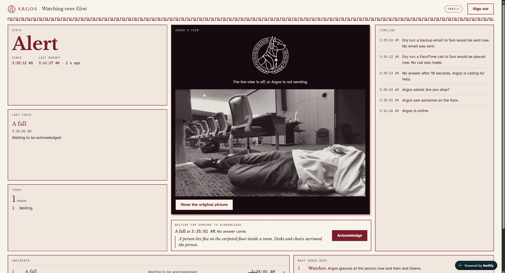

# Argos

A companion robot dog that keeps watch over someone who is recovering, elderly, or needs
looking after. It asks before it worries anyone, and sends word when something is wrong.

Built in 24 hours at HackUTA 2026, my first hackathon, on no sleep. The theme was Homer's
Odyssey. Argos is the dog who kept watch for twenty years and was the first to recognize
Odysseus when he came home.

All of the software in this repository is my own work: the design, the contract between the
parts, the robot's brain, the call agent, the dashboard and the database rules.

Hasan Mustafa Rizvi

## What it does

1. **Watches.** A camera tracks one person's pose and looks for a fall or a long stillness.
2. **Asks first.** It turns to the person and says "Are you okay?" out loud.
3. **Stands down** on a pat on the head. Nothing about that moment is stored.
4. **Sends word** if ten seconds pass with no answer. It texts a family member over
   iMessage, then calls them on FaceTime. On the call Argos speaks for itself, says what it
   saw and when, and the video is the dog's own camera. "I'm on my way" clears the alert.

A dashboard shows family and clinicians what happened. Family see the timeline, the one
picture taken when a check went unanswered, and a live view. Clinicians see the history and
never an image. Both sign in with a password and an authenticator code.

Nothing has to be worn and nothing is recorded continuously. A check that ends well leaves
no picture and no description, and the database refuses to store one.

## The dashboard



The family view during an unanswered check on the real robot. The camera saw someone on the
floor, Argos asked, and nobody answered. The picture taken at that moment is drawn as an
engraving, with the plain original one click away, and the summary under it was written from
the frame. This run was a dry run, so the timeline says what would have been sent.

## What ran on the real robot

Everything below was seen working on the hardware during the event, not only in tests.

- The camera raised a fall by itself when a person lay on the floor.
- A pat on the head stood the dog down, 15 times out of 15, and a light tap was ignored.
  There is no touch sensor: the brain compares where the head's motors were told to be with
  where they are.
- An unanswered check placed a real FaceTime video call to an iPhone. The call showed the
  dog's live camera, and saying "I'm on my way" cleared the alert and calmed the dog.
- The brain survived its own sound card dropping off USB, and restarted itself into an open
  alert without raising it twice.

What did not work, said plainly:

- The robot's microphones were dead, so a spoken "I'm fine" and a spoken call for help,
  both of which are built, could not be shown.
- The wheels drove, but from a hand-run command. The automatic approach is written and
  tested in software and was not connected to the motors in time.

## How it is built

| Part | What it is |
|---|---|
| `brain/` | Python on a Raspberry Pi 5 driving a Reachy Mini Lite. MediaPipe pose tracking, a three-state machine (calm, checking, alert), the head press, the voice, and a separate guard process that owns the motor pins. 339 tests. |
| `call/` | The call agent. It learns of an escalation from the backend, sends the iMessage and places the FaceTime call through Chert into a LiveKit room, speaks with ElevenLabs and answers questions with Gemini. 83 tests. |
| `web/` | The dashboard. React, TypeScript, Vite and Tailwind on Netlify. 101 tests. |
| `supabase/` | Postgres schema and access rules. Row level security on every table, a second factor required for every read, and a private Realtime channel for the live view that stores nothing. |
| `contract/` | One document that fixes every name, state and record. It was written before any code, so the three programs were built side by side against it. |
| `design/` | Visual identity, logo and the web build plan. |
| `docs/` | Architecture and the build tracker, including the log of the first night on the hardware. |

Each part runs alone. The dashboard runs with no backend, and the brain runs with no robot,
no camera and no network.

## Trying it

The dashboard is at https://argos-is-furreal.health. The keys from the event have been
revoked, so sign-in no longer works. Open the demo there to watch a scripted run as family
or as a clinician.

To run the dashboard locally:

```
cd web
npm install
npm run dev
```

The brain and the call agent each have their own README with setup and commands.

## Credits

Argos builds on other people's work, used under their licenses and credited here.

- **Cobalt Toile Landing** by Kedhareswer Naidu (MIT). The landing page template.
- **Ridgeline Dither Footer**, **Sign-in page**, **Brutalist bento dashboard** and
  **Finance bento** (Roman Vasnev), published on 21st.dev. Technique and layout references
  for the dither scenes, the sign-in page and the dashboard grid.
- **Liquid Glass Logo Reveal**, published on 21st.dev, with its shader ported from **Glass
  Icon Reveal** by Zanwei Guo (MIT). The logo reveal after sign-in.
- **HackUTA 2026** website. Reference for the Odyssey theme.
